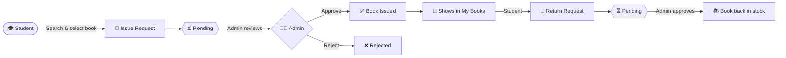

<div align="center">

# 📚 Library Management System

### *A role-based, request-approval driven library portal — built with Node.js, Express & vanilla JavaScript*

<br>


<br>

**[✨ Features](#-features) • [🧰 Tech Stack](#-tech-stack) • [🔄 Workflow](#-how-it-works) • [🚀 Quick Start](#-quick-start) • [🔌 API](#-api-reference) • [🗂️ Structure](#️-project-structure) • [🛣️ Roadmap](#️-roadmap)**

</div>

---

## 🌟 About The Project

The Library Management System is a full-stack web application that digitizes the complete workflow of a college library. Students search for books and send **issue / return requests**, and an **admin** approves or rejects them. Everything is managed from a clean dashboard: inventory, requests, issued books, students, and analytics.

> 💡 **Why this project?** It replaces paper registers and manual entries with a simple, fast, and transparent system where every request has a trackable status: `pending → approved / rejected`.

---

## ✨ Features

### 🎓 Student Portal
| Feature | Description |
|---|---|
| 🔐 **Secure Register / Login** | Roll number + password with role-based access |
| 🔍 **Live Book Search** | Results filter as you type |
| 📩 **Issue Request** | Request a book in one click; duplicate pending requests are disabled (`⏳ Requested`) |
| 📖 **My Books** | See all currently issued books in one place |
| 🔁 **Return Request** | Request to return a book |
| 📋 **My Requests** | Track the status of every request you've made |

### 👨‍💼 Admin Dashboard
| Feature | Description |
|---|---|
| 📊 **Library Stats** | Interactive analytics chart powered by Chart.js |
| ➕ **Add Books** | Add books with title, author, department, and quantity |
| ✏️ **Edit Books** | Quick updates through a modal |
| 🔎 **Search + Department Filter** | Combine title search with a department filter |
| ✅ **Request Approval Engine** | Approve or reject issue and return requests |
| 📚 **Issued Books View** | See which book is with which student |
| 👥 **Students Overview** | List of all registered students |
| 🏆 **Top Readers & Top Books** | Most active students and most popular books |

### 🎨 UI / UX
- 🌙 **Dark / Light theme** toggle (preference saved in `localStorage`)
- 🔔 **Toast notifications** for every action
- 🧭 **Sidebar navigation** with active-state highlight
- 🪟 **Modal-based editing**
- 📱 Clean, card-based layout

### 🔒 Security
- Passwords are hashed with **bcrypt** (`10` salt rounds); plain-text passwords are never stored
- Login matches both **roll number and role**
- **Role-based redirects** on admin and student pages

---

## 🧰 Tech Stack

| Layer | Technology |
|---|---|
| **Frontend** | HTML5, CSS3, Vanilla JavaScript |
| **Charts** | [Chart.js](https://www.chartjs.org/) (via CDN) |
| **Backend** | Node.js, Express 5 |
| **Auth** | bcryptjs (password hashing) |
| **Database** | MongoDB Atlas (JSON files in `data files/` are used only as seed data) |
| **Session** | `sessionStorage` (client side) |

---

## 🔄 How It Works



**Request lifecycle:**

1. A student sends an **issue request** for a book → status is `pending`
2. The request appears on the admin dashboard (only pending ones are shown)
3. The admin **approves** it → the book's `issued` count increases and the student is added to its `issuedTo` list
   *(or* **rejects** *it → status becomes `rejected`)*
4. To give the book back, the student sends a **return request** → the admin approves it → the copy returns to stock
5. Requests are never deleted, only their status changes, so a **complete history** is preserved

---

## 🚀 Quick Start

### Prerequisites
- [Node.js](https://nodejs.org/) **v18 or higher**
- npm (comes with Node)

### Installation

```bash
# 1. Clone the repository
git clone https://github.com/PrachiPriya-203/lib_management.git

# 2. Move into the project folder
cd lib_management

# 3. Install dependencies
npm install

# 4. Add your database URL (copy .env.example to .env and fill MONGODB_URI)

# 5. (One time) upload the sample data to MongoDB
npm run seed

# 6. Start the server
npm start
```

### Open in your browser

```
http://localhost:5000
```

You should see this in the console:

```
🚀 Server is running on http://localhost:5000
```

### First-time setup

1. Go to the `/register` page and create an **Admin** account
2. Create one or more **Student** accounts
3. Log in as admin and **add a few books**
4. Log in as a student, send a **request**, then approve it from the admin account 🎉

### ☁️ Deploy on Vercel

1. Create a free cluster on [MongoDB Atlas](https://www.mongodb.com/atlas) and copy the connection string
2. In Atlas → **Network Access**, add `0.0.0.0/0` (Vercel uses dynamic IPs)
3. Push this repo to GitHub and import it in [Vercel](https://vercel.com)
4. In Vercel → **Settings → Environment Variables**, add `MONGODB_URI` (and optionally `DB_NAME`)
5. **Redeploy** — environment variables apply only to new deployments

> Vercel's filesystem is read-only, which is why data lives in MongoDB instead of JSON files.

---

## 🔌 API Reference

Base URL: `http://localhost:5000`

### 🔐 Auth
| Method | Endpoint | Description |
|:---:|---|---|
| `GET` | `/` | Serves the login page |
| `POST` | `/register` | Register a new user (password is hashed) |
| `POST` | `/login` | Log in with roll number, role, and password |

### 📚 Books
| Method | Endpoint | Description |
|:---:|---|---|
| `GET` | `/books` | Get all books |
| `POST` | `/addBook` | Add a new book *(admin)* |
| `PUT` | `/edit/:id` | Update book details *(admin)* |

### 📩 Requests
| Method | Endpoint | Description |
|:---:|---|---|
| `POST` | `/request/:bookId` | Send an issue request |
| `POST` | `/returnRequest/:bookId` | Send a return request |
| `GET` | `/requests` | Get all **pending** requests *(admin)* |
| `GET` | `/myRequests/:roll` | Get all requests of one student |
| `POST` | `/approve/:reqId` | Approve a request *(admin)* |
| `POST` | `/cancel/:reqId` | Reject a request *(admin)* |

### 📊 Analytics
| Method | Endpoint | Description |
|:---:|---|---|
| `GET` | `/analytics` | Top 5 students + top 5 books |

<details>
<summary><b>📦 Example: Register request</b></summary>

```http
POST /register
Content-Type: application/json

{
  "name": "Aditi",
  "roll": "245",
  "dept": "CSE",
  "phone": "9845665230",
  "password": "yourPassword",
  "role": "student"
}
```
</details>

<details>
<summary><b>📦 Example: Analytics response</b></summary>

```json
{
  "topStudents": [
    { "name": "Aditi", "roll": "245", "dept": "CSE", "count": 3 }
  ],
  "topBooks": [
    { "title": "Introduction to Algorithms", "count": 2 }
  ]
}
```
</details>

---

## 🗃️ Data Models

<details>
<summary><b>👤 User</b></summary>

```json
{
  "id": "1776935172611",
  "name": "Aditi",
  "roll": "245",
  "dept": "CSE",
  "phone": "9845665230",
  "password": "$2b$10$...hashed...",
  "role": "student"
}
```
</details>

<details>
<summary><b>📖 Book</b></summary>

```json
{
  "id": "1776935662474",
  "title": "Introduction to Algorithms",
  "author": "Thomas H. Cormen",
  "dept": "CSE",
  "qty": 10,
  "issued": 2,
  "issuedTo": [
    { "name": "Aditi", "roll": "245", "dept": "CSE", "issuedAt": 1777217662582 }
  ]
}
```

> **Available copies = `qty − issued`**
</details>

<details>
<summary><b>📩 Request</b></summary>

```json
{
  "id": "1776943163839",
  "type": "issue",
  "status": "pending",
  "bookId": "1776935318979",
  "student": { "name": "Aditi", "roll": "245", "dept": "CSE", "role": "student" }
}
```

`type` → `issue` | `return` &nbsp;•&nbsp; `status` → `pending` | `approved` | `rejected`
</details>

---

## 🗂️ Project Structure

```
📦 lib_management
 ┣ 📂 data files          # seed data only
 ┃ ┣ 📄 books.json         # Book inventory
 ┃ ┣ 📄 requests.json      # Issue / return requests
 ┃ ┗ 📄 users.json         # Students & admins
 ┣ 📂 public
 ┃ ┣ 📄 login.html         # Login page
 ┃ ┣ 📄 register.html      # Registration page
 ┃ ┣ 📄 admin.html         # Admin dashboard
 ┃ ┣ 📄 admin.js           # Admin logic
 ┃ ┣ 📄 student.html       # Student dashboard
 ┃ ┣ 📄 student.js         # Student logic
 ┃ ┗ 📄 style.css          # Styling + themes
 ┣ 📄 server.js            # Express server & REST API
 ┣ 📄 seed.js              # Uploads sample data to MongoDB
 ┣ 📄 vercel.json          # Vercel config
 ┣ 📄 .env.example         # Environment variable template
 ┣ 📄 package.json
 ┗ 📄 README.md
```

---

## 🖼️ Screenshots

> 📸 Add your project screenshots to a `screenshots/` folder and update the links below.

| Login | Student Dashboard |
|:---:|:---:|
|  |  |

| Admin Dashboard | Analytics |
|:---:|:---:|
|  |  |

---

## 🛣️ Roadmap

- [ ] 🔑 JWT-based authentication & protected admin routes
- [ ] 📅 Due dates, return deadlines, and fine calculation
- [ ] 📧 Email / SMS notifications
- [ ] 📷 Book cover images & categories
- [ ] 📄 Export reports (PDF / CSV)
- [ ] 🧪 Unit & integration tests
- [ ] 🐳 Docker support

---

## 🤝 Contributing

Contributions are welcome! 🙌

1. **Fork** the repository
2. Create a feature branch: `git checkout -b feature/AmazingFeature`
3. Commit your changes: `git commit -m "Add AmazingFeature"`
4. Push the branch: `git push origin feature/AmazingFeature`
5. Open a **Pull Request**

---

## 👩‍💻 Author

<div align="center">

**Prachi Priya**

[](https://github.com/PrachiPriya-203)

</div>

---

<div align="center">

### ⭐ If you like this project, don't forget to give it a star! ⭐

*Made with ❤️ and lots of ☕*

</div>
